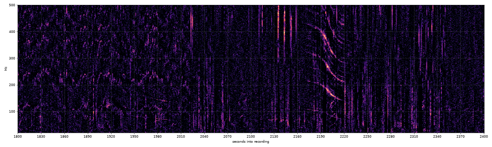
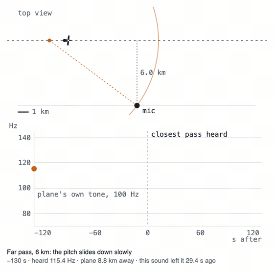
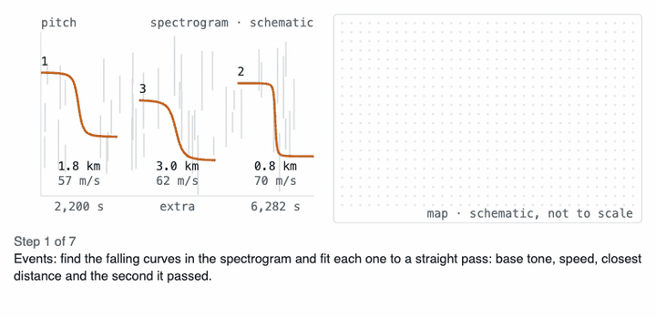
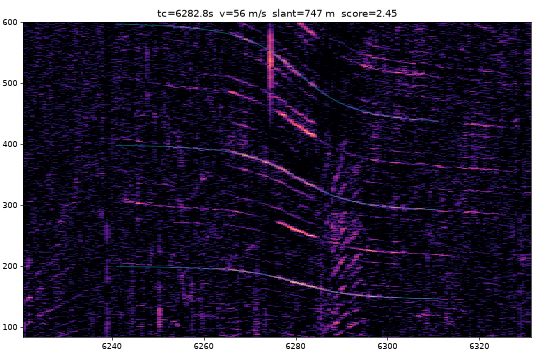

# geodoppler

Find where a recording was made from the sound of small planes flying past the microphone.



Ten minutes of a backyard bird-feeder livestream in Northeast Ohio, 20-500 Hz. You can't hear it, but the three
lines falling together around 2,200 s are one propeller plane passing by: harmonics of its blade tone,
bent down by the Doppler effect.

The idea comes from [@colsto](https://www.youtube.com/@colsto)'s video
[I discovered a sound that leaks your exact location](https://youtu.be/UytYrhYLOKI). The story of building this
version, with what worked and what didn't, is in the
[blog post](https://dreamiurg.net/2026/11/09/geolocating-backyard-bird-cams-by-listening-for-small-planes.html).

## How it works

**1. A passing plane draws a curve.** The pitch falls as the plane goes by. A close pass drops sharply, a far pass
slides slowly, so the curve's shape gives the plane's speed, how close it came, and the second it passed.



**2. Real planes left a record.** Planes broadcast their position (ADS-B), and [adsb.lol](https://adsb.lol) keeps
the history. geodoppler searches a 200 m grid for the spot where real tracks would have drawn the curves in the
audio, with the right gaps between them, then checks every other curve in the recording against the planes that
were there.



**3. The answer is a pin and a clock.** It returns the spot, the second the recording started, the aircraft it
heard, and a confidence of `high` or `low`. Here the fitted model (thin cyan line) sits on the ridges of a
Cessna 172 passing 747 m from the microphone:



## Try it

```bash
uv sync
uv run pinpoint run 'https://youtu.be/4CxVxuMVkMc' --date 2026-09-08 --bbox 40.9,-73.5,120
```

That is [@colsto](https://www.youtube.com/@colsto)'s raw recording, searched within 120 km on its day. Output lands in `runs/<id>/`: `map.html`
(satellite map, candidate heat, matched flight tracks) and `result.json`. Needs `yt-dlp` and `ffmpeg` on PATH.
The first search of a day downloads about 4 GB of ADS-B history and keeps a 700 MB slice of small planes.

The command is still called `pinpoint`, the project's first name.

## Does it work?

- On [@colsto](https://www.youtube.com/@colsto)'s raw recording it lands on the spot the video names. On a railroad cam in Huron, Ohio it lands
  0.21 km from the camera with 5 aircraft matched.
- It needs the right recording: unedited audio with a small plane within about 8 km, two for an unknown start
  time. Most recordings have none, and then it finds no flyovers at all; a weak match comes back as `low`.
- On 36 livestreams it had never seen, given each stream's day and a region of 150-250 km, it got the start time
  right for 6. With `--decoys 5` (the same search on 5 other days) it said `high` twice, both right, and never
  for a wrong answer. That threshold rests on few cases, so treat it as provisional.

## Privacy

This can place a microphone to within a few hundred meters from background noise. Some recordings used here are
livestreams from private homes; their coordinates in this repo are rounded to 0.01° (about 1 km) on purpose.
Please do the same if you publish results about someone else's recording.

<details>
<summary>Commands, pipeline and validation details</summary>

### Commands

```bash
uv run pinpoint fetch URL                       # runs/<id>/: meta.json, audio, overview/*.png spectrograms
uv run pinpoint events runs/<id>                # auto-detect flyovers -> events.json, events.png
uv run pinpoint events runs/<id> --box 2080,2240,80,190,1+2 --box 2990,3140,95,185   # or pick them
uv run pinpoint locate runs/<id> --date YYYY-MM-DD --bbox lat0,lon0,lat1,lon1   # or lat,lon,km | conus
uv run pinpoint locate runs/<id> --bbox conus --start 2026-09-08T20:17:30       # one event + known time
uv run pinpoint locate runs/<id> --date YYYY-MM-DD --bbox lat,lon,km --decoys 5   # confidence vs 5 other days
uv run pinpoint frames runs/<id>                # stills, for visual clues when there is no aircraft audio
uv run pinpoint pin runs/<id> LAT LON --note "..."   # map a location judged from other clues
```

`result.json` holds the best lat/lon, the recording start time to the second, the aircraft heard and the score
margin. ADS-B days cache under `$PINPOINT_DATA` (default `~/.cache/pinpoint`).

### Pipeline

1. **Events** (`doppler.py`): whitened spectrogram with steady lines suppressed; sliding-window fit of an
   ideal straight-line flyover (f0, speed, slant distance, CPA time) by differential evolution;
   visible harmonics detected and scored too.
2. **Candidates** (`search.py`): 200 m grid; for each event, track segments whose ground speed fits; for every
   grid point in reach, delayed CPA time (CPA + slant/c) and slant distance. Jets and rotorcraft (known ICAO
   types) are dropped up front.
3. **Filters**: CPA-time offset between the two strongest events (±10 s); silence (no other non-jet passes
   close in between, ignoring ±60 s around each event's CPA).
4. **Scoring**: per surviving point (100 m), the emission-time Doppler curve of each real track
   (`flyover.py`), brightness summed along it. Event 1 absorbs measurement error (±6 s, ±4 % f0); event 2 is
   locked to geometry (±2 s). Stage 1 at the plain radial velocity; stage 2 re-scores the best points of every
   aircraft combination with a ±15 % radial-velocity scale sweep. That scale absorbs sound-speed and geometry
   error, not wind: Doppler follows ground speed, and wind only shifts the effective sound speed (~W/c).
5. **Verification**: every other detected event must be explained, time-locked, by some real aircraft at
   the candidate; that adds to the score (0 if none, so a spurious event costs nothing).
6. **Confidence**: with `--decoys N` (use 5), the same search also runs on the N nearest other cached ADS-B
   days (never downloaded; `--start` shifted to the same time of day). `high` then needs the score to be
   >= 1.2x the best decoy-day score (`decoy_ratio`, `decoy_scores` in result.json; a decoy with no match
   scores 0), at least 3 events, and every primary event explained at a Doppler scale within 1 ± 0.08
   (`doppler_scale`; right matches sit at 0.94-1.05). It costs one extra search per decoy day. Without
   decoys, `high` needs a >= 15 % margin over the next aircraft combination plus the same Doppler-scale
   check; that rule is weak (it read `high` on 11 of 65 wrong-day runs).

### Validation

22 public YouTube recordings with a known place and day (`validation/candidates.json`), searched within
100 km of the truth on the known UTC day, start time unknown (`validation/run.py`).

| Recording | Flyovers | Result | Error | Margin -> confidence |
| --- | --- | --- | --- | --- |
| colsto raw audio (4CxVxuMVkMc), 2°×2° box | 3 | located, start 20:17:28 UTC | matches the video (truth given to 0.01°) | 18 % -> high |
| Huron OH railcam, Oct 18 2026 (u8qudttB8PI) | 8 | located, 5 aircraft matched | 0.21 km | 50 % -> high |
| Huron OH railcam, Aug 15 2026 (cq68vWhv8DQ) | 2 | wrong spot | 25 km | 6 % -> low |
| Panama City Beach boat ramp (7IrHU1tydh4) | 2 | wrong spot (boat Doppler?) | 105 km | 8 % -> low |
| Huron OH railcam, Sep 1 2026 (SemiF2yUFzk) | 1 | wrong spot; now refused | 69 km | 0.8 % -> low |
| colsto audio, 1 event + known start, all CONUS | 1 | wrong state (Kansas) | ~2200 km | 0.6 % -> low |
| Viroqua WI field recording (MjWQyWLvoVw) | 4 | no match (recording date unsure) | | |
| Oshkosh 2025 arrivals (x2sVBsOfsmI) | 12 | wrong spot (landing traffic) | 22 km | 0.04 % -> low |
| 6 airport / beach webcams, 2 field recordings, 2 railcam days | 0 | no flyovers detected | | |
| 6 webcam archives | | silent audio track | | |

In this 100 km set every `high` answer was right and every wrong answer was flagged `low` (only 2 high
answers). Wider 150-300 km searches broke that: two `high` answers (19 % and 32 %) were wrong, one of them
matched medical helicopters. After dropping rotorcraft, widening the silence guard, sweeping every combination
and adding the Doppler-scale check, none of 23 labeled recordings (`validation/eval.py`) gets a wrong `high`.
On 36 held-out livestreams nothing was tuned on (`experiments/heldout`; each search was given the stream's day
and a 150 or 250 km circle around the channel's stated region), 4 were found at first and 6 after two recall
fixes (`experiments/recall/REPORT.txt` sorts the misses: looped audio, jets, no ADS-B, or the right aircraft
pair outranked by a coincidence). After the fixes the margin rule said `high` 4 times and was wrong once; the
`--decoys 5` rule said `high` twice, both right, and never for a wrong answer. Airport plane-spotting streams
fail: ground operations and landings are not straight constant-speed flyovers. Full table:
`validation/results.md`.

### Limits

- Jets low on approach do make clean Doppler tones, but they are excluded: too many look-alike tracks.
- Coverage = adsb.lol receivers (dense in US/Europe), history from 2023.
- Ground elevation comes from Copernicus GLO-90 (downloaded per 1° tile on first use).
- One UTC day of tracks per search; a recording across midnight UTC needs `--days 2`.
- One flyover is not enough without a known start time, and not enough for a CONUS-wide search even with one.

</details>

## License

[MIT](LICENSE)
